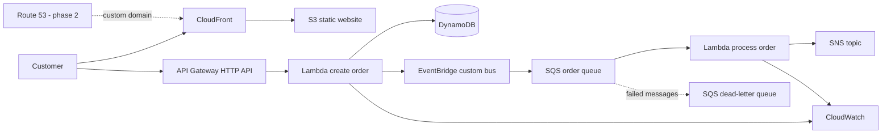

# Café 53

Café 53 is a small serverless ordering platform built to connect hands-on AWS
practice with the AWS Certified Cloud Practitioner (CLF-C02) exam domains.

The project intentionally favors managed, pay-per-use services and keeps every
resource in Terraform so the environment can be created, inspected, and
destroyed repeatably.

**Live demo:** [https://d3ujlt4nmaiwzc.cloudfront.net](https://d3ujlt4nmaiwzc.cloudfront.net)

The `dev` environment is deployed in `us-east-1`. See
[docs/deployment.md](docs/deployment.md) for verification evidence.

## Architecture



See [docs/architecture.md](docs/architecture.md) for the request flow and
[docs/clf-c02-map.md](docs/clf-c02-map.md) for the certification study map.

## What this first version includes

- S3 private bucket for the frontend, served only through CloudFront.
- API Gateway HTTP API with `POST /orders` and `GET /health`.
- Python Lambda that validates and stores orders in DynamoDB.
- Custom EventBridge bus and rule for `OrderCreated` events.
- SQS queue with a dead-letter queue and redrive policy.
- Python worker Lambda subscribed to SQS.
- SNS topic for order-ready events (no paid or personal subscription by default).
- CloudWatch log groups with configurable retention.
- AWS Budget resource, mandatory project tags, and conservative defaults.
- Optional Route 53/custom-domain work documented for phase 2.

## Safety and cost

The repository does **not** run `terraform apply` automatically. The CI workflow
formats and validates Terraform only. Review `terraform plan` before every
deployment and run `terraform destroy` after a study session if you do not need
the environment online. The learning frontend bucket uses `force_destroy` so
its disposable object versions do not prevent a complete lab teardown.

CloudFront, API Gateway, Lambda, DynamoDB, EventBridge, SQS, SNS, S3 and
CloudWatch can still generate charges. The account-level monthly budget sends a
forecast alert at 80% and an actual-cost alert at 100%; AWS Budgets does not
automatically stop resources.

## Prerequisites

- Terraform 1.13+
- AWS CLI configured with an authorized profile
- Python 3.11+
- An AWS account where you are allowed to create the resources in this project

## Validate locally

```powershell
terraform -chdir=terraform fmt -check -recursive
terraform -chdir=terraform init -backend=false
terraform -chdir=terraform validate
python -m unittest discover -s app/functions -p "test_*.py"
```

## Deploy when ready

```powershell
Copy-Item terraform/terraform.tfvars.example terraform/terraform.tfvars
Copy-Item terraform/backend.hcl.example terraform/backend.hcl
terraform -chdir=terraform/bootstrap init
terraform -chdir=terraform/bootstrap apply
terraform -chdir=terraform init -backend-config=backend.hcl
terraform -chdir=terraform plan -out cafe53.tfplan
terraform -chdir=terraform apply cafe53.tfplan
```

The bootstrap stack creates a private, encrypted and versioned S3 bucket for
remote state. The main stack uses Terraform's native S3 lock file. Bootstrap
state remains local and the state bucket is protected with `prevent_destroy`.

After deployment, Terraform prints the CloudFront URL and API endpoint. The
frontend receives the API URL through a generated `config.js` object.

## Suggested study workflow

1. Read the service comparison in `docs/clf-c02-map.md`.
2. Run `terraform plan` and identify every planned AWS service.
3. Apply the environment only after reviewing estimated cost and IAM changes.
4. Place a test order and follow it through API Gateway, Lambda, DynamoDB,
   EventBridge, SQS, the worker Lambda, SNS and CloudWatch.
5. Send one intentionally invalid request and inspect the HTTP response and logs.
6. Destroy the stack and explain which data would be durable in production.

## Roadmap

- Phase 1: serverless order flow and observability.
- Phase 2: Route 53 custom domain, ACM certificate and API custom domain.
- Phase 3: Cognito authentication, WAF and CloudTrail study exercises.
- Phase 4: dashboard, alarms, backup/restore exercise and portfolio case study.

